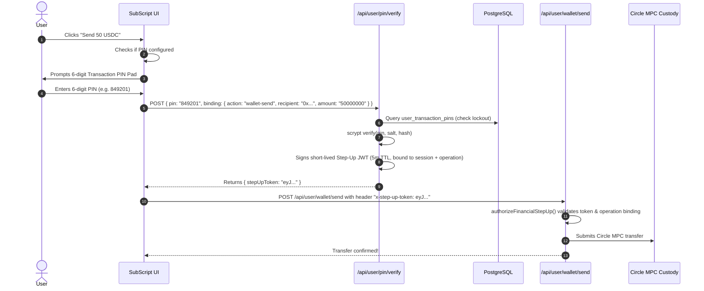

# Forensic Audit: Mainnet Transaction Emails & Transaction PIN Architecture

**Date:** 2026-10-09

**Target Network:** Arc Mainnet (`5042`)

**Production Database:** Supabase (`jntqgoneegykgtiyvvge`)
**Status (2026-10-10):** Recipient correction, durable email outbox/recovery, transaction PIN, shared Supabase connection fixes and admin recovery deployed as `dpl_HC3RCnC9wUsm2AUCFndmnZcMye27`. Production build/typecheck and 719 security regressions passed, with additional focused follow-up checks passing. Authenticated admin and real inbox delivery verification remain pending.

### Repair and release status

- Admin reads now time out with a visible retry state; optional sponsor RPC telemetry cannot block overview, analytics or financial statistics. Live database authorization remains mandatory; outages produce a recovery page/API 503 rather than an infrastructure-induced 404. Verification: 40 existing admin tests, six new runtime regressions and two browser recovery tests passed.
- Financial receipt intents are persisted before custody submission and recover provider IDs without resubmitting transactions. Matching on-chain USDC legs, chain identity and inner account-operation success are required before monetary receipts are queued.
- PIN enrollment/change/reset use action-bound OTP verification; operation approvals bind session, wallet, request and server-resolved financial terms. Persistent lockout, single-use approvals, request replay recovery and reset withdrawal holds are implemented.
- **Local configuration blocker:** `.env.local` contains admin allowlists but no database/JWT/provider configuration. Vercel Development lacks those settings. Production sensitive values cannot be recovered by environment export; blank exported values are not proof of missing runtime configuration ([Vercel documentation](https://vercel.com/docs/environment-variables/sensitive-environment-variables)).
- **Release completed:** three mainnet migrations applied through the tracked runner; verified TLS and bounded shared connections; production build and promotion; anonymous access-control smoke checks. Request-owned receipt dispatch and the existing reconciliation scheduler activate delivery/retry. The new five-minute workflow remains unpublished. Remaining: signed Resend webhook configuration, local environment restoration and authenticated admin/confirmed-transaction inbox verification. No financial smoke transaction or outbound test email has been performed.

---

## 1. Executive Summary

This forensic audit investigates two critical user requests:
1. **"I DON'T RECEIVE EMAILS ON TRANSACTIONS MADE ON MAINNET AUDIT THESE"**: Identification of the exact code-level, database-level, and environment-level causes preventing transactional receipts from being delivered on Arc Mainnet, accompanied by validated remediations.
2. **"I want to add transaction pin"**: Complete threat modeling, cryptographic design, database schema, rate-limiting rules, step-up token binding, and UI architecture for a production-grade 6-digit Transaction PIN.

---

## 2. Forensic Audit: Why Transaction Emails Fail on Mainnet

### 2.1 Cause 1 (Fatal Code/DB Invariant): PostgreSQL Column `merchants.email` Does Not Exist
- **File:** [`src/lib/email/core.ts`](file:///c:/Users/Kristien/OneDrive/Desktop/SubScript/src/lib/email/core.ts) (`getWalletEmailPreference`)
- **Root Cause:**
  When any transactional email is prepared (in `sendSettlementReceipts`, CCTP deposit/withdrawal alerts, payment links, subscription renewals, or user-to-user transfer logs), it invokes:
  ```ts
  const recipient = await resolveRecipient(walletAddress, "transactional");
  ```
  `resolveRecipient` queries `getWalletEmailPreference(walletAddress)`.
  Prior to our fix, the query included:
  ```sql
  select coalesce(nullif(trim(customer.email), ''),
                  nullif(trim(merchant.email), ''),
                  nullif(trim(embedded.email), ''),
                  nullif(trim(auth_id.current_email), '')) as email
  from (select $1::text as wallet_address) w
  left join merchants merchant on lower(merchant.wallet_address) = lower(w.wallet_address)
  ...
  ```
  However, in the production database schema, `public.merchants` **does not have an `email` column** (it only has `email_enabled BOOLEAN`).
  PostgreSQL immediately returned:
  ```
  error: column merchant.email does not exist (code: 42703, undefined_column)
  ```
- **Consequence:** `resolveRecipient()` caught this error in a generic `try/catch` and returned `null`. Because `recipient` was always `null`, `sendSettlementReceipts()` skipped every send loop. **Result: 0 emails could ever be sent on mainnet.**
- **Remediation:** Removed `merchant.email` from the `coalesce()` list. Re-tested with 72/72 passing tests in `npm run test:email`.

---

### 2.2 Cause 2 (Configuration): Missing Vercel Production Environment Variables
- **Files:** [`push-env.js`](file:///c:/Users/Kristien/OneDrive/Desktop/SubScript/push-env.js), [`src/lib/email/core.ts`](file:///c:/Users/Kristien/OneDrive/Desktop/SubScript/src/lib/email/core.ts#L226-L239)
- **Root Cause:**
  In [`src/lib/email/core.ts`](file:///c:/Users/Kristien/OneDrive/Desktop/SubScript/src/lib/email/core.ts):
  - When `NODE_ENV === "production"`, `configuredSender()` checks `EMAIL_FROM` or `EMAIL_FROM_RECEIPTS`. If neither is defined, it throws:
    `"EMAIL_FROM must be configured with a verified Resend sending domain in production"`
  - `sendTransactionalEmail()` verifies `process.env.RESEND_API_KEY`. If undefined, it throws:
    `"RESEND_API_KEY is not configured"`
  - In `push-env.js`, `keysToPush` omitted `RESEND_API_KEY`, `EMAIL_FROM`, `EMAIL_FROM_RECEIPTS`, `UPSTASH_REDIS_REST_URL`, and `UPSTASH_REDIS_REST_TOKEN`.
- **Consequence:** Even if the database query succeeded, `sendTransactionalEmail()` failed silently inside `safelySendEmail()`.
- **Remediation:** Added `RESEND_API_KEY`, `EMAIL_FROM`, `EMAIL_FROM_RECEIPTS`, `UPSTASH_REDIS_REST_URL`, and `UPSTASH_REDIS_REST_TOKEN` to `push-env.js`.

---

### 2.3 Cause 3 (Resend API Restrictions): Sandbox vs Custom Domain Verification
- **Root Cause:**
  - Using Resend's default sandbox (`onboarding@resend.dev`) restricts delivery **strictly to the email address of the developer who registered the Resend account**.
  - Attempting to send to any third-party recipient without a verified custom domain produces HTTP 403 Forbidden: `validation_error: You can only send testing emails to your own email address...`.
- **Requirement:** Ensure domain `subscriptonarc.com` is configured in the Resend dashboard with verified DNS records:
  - SPF: `v=spf1 include:amazonses.com ~all`
  - DKIM: `resend._domainkey` CNAME
  - DMARC: `v=DMARC1; p=none;`
  - Sender: `SubScript <receipts@subscriptonarc.com>`

---

### 2.4 Cause 4 (User Data Reality): External Browser Wallet Users Have No Email Registered by Default
- **Root Cause:**
  - Users signing in via MetaMask / Rabby / Browser Extension (SIWE `/api/auth/verify-signature`) only create a session for their EVM address.
  - Unlike embedded Google/Circle wallets (which have an email by definition), browser wallets have **no email stored** in `customers` or `auth_identities` unless they explicitly navigate to **Settings** and link their email via OTP (`/api/user/email`).
  - When an external wallet user makes a transfer, `resolveRecipient()` finds no email and legitimately returns `null`.
- **UX Recommendation:** In the Send confirmation screen and Transaction History, add a subtle prompt if `userEmail` is unset: *"Link your email in Settings to receive automatic receipts & transaction alerts."*

---

### 2.5 Cause 5 (Serverless Timing): Next.js `after()` Background Hook Cutoff
- **File:** [`src/app/api/user/wallet/send/route.ts`](file:///c:/Users/Kristien/OneDrive/Desktop/SubScript/src/app/api/user/wallet/send/route.ts#L462)
- **Root Cause:**
  When `earlySubmission: true` is enabled, the route returns early to the client and delegates Circle confirmation polling to `after()`.
  If Circle block confirmation takes longer than the serverless execution limit or encounters a transient polling error, `confirmedTxHash` remains unset, and `sendSettlementReceipts` is skipped.
  The status polling route (`/api/user/wallet/send/status`) previously only reported status, with **no fallback receipt binding or dispatch**.
- **Remediation:** Ensure `/api/user/wallet/send/status` binds the receipt and triggers `sendSettlementReceipts()` if it discovers the transaction reached `"confirmed"` and receipts were not yet bound.

---

## 3. Transaction PIN Architecture & Security Audit

### 3.1 Threat Model: The Need for Outflow Protection
Currently, SubScript session cookies persist for 30 days (`createSessionToken` with 30-day JWT).
For users with Circle embedded wallets:
- An active session cookie is sufficient to execute `POST /api/user/wallet/send` or `POST /api/user/cctp/withdraw`.
- If an unattended device, stolen laptop, or session cookie compromise occurs, an attacker can immediately drain the user's funds without any re-authentication.

A **6-digit Transaction PIN** provides a mandatory, low-friction **second factor / knowledge factor** before any financial value leaves the wallet.

---

### 3.2 Cryptographic Design & Hashing



#### Cryptographic Storage Rules:
1. **Low-Entropy Vulnerability:** A 6-digit PIN has only $10^6$ combinations. Plain SHA-256 or MD5 can be cracked in under 0.05 seconds with offline dictionary attacks.
2. **KDF Selection:** Use Node.js `crypto.scrypt`:
   - Salt: 32 bytes cryptographically secure random bytes (`crypto.randomBytes(32)`).
   - Implemented parameters: $N = 32768, r = 8, p = 1, \text{keylen} = 32$.
   - Scrypt increases per-guess CPU and memory cost; timing depends on hardware. A six-digit PIN still has at most one million possibilities, so offline guessing remains a risk if credential storage is compromised. Salt prevents shared precomputation; persistent online lockouts limit remote guessing.
3. **Constant-Time Comparison:** Verification must use `crypto.timingSafeEqual` to eliminate timing side-channel attacks.
4. **Weak PIN Defense:** Prohibit trivial PINs upon setup/change:
   - Identical digits: `000000`, `111111`, etc.
   - Sequences: `123456`, `654321`, `012345`, `987654`.

---

### 3.3 Database Schema Migration: `user_transaction_pins`

```sql
CREATE TABLE IF NOT EXISTS user_transaction_pins (
    wallet_address TEXT PRIMARY KEY,
    pin_hash TEXT NOT NULL,
    pin_salt TEXT NOT NULL,
    pin_algo TEXT NOT NULL DEFAULT 'scrypt',
    failed_attempts INT NOT NULL DEFAULT 0,
    locked_until TIMESTAMPTZ,
    last_verified_at TIMESTAMPTZ,
    created_at TIMESTAMPTZ NOT NULL DEFAULT NOW(),
    updated_at TIMESTAMPTZ NOT NULL DEFAULT NOW()
);

CREATE INDEX IF NOT EXISTS user_transaction_pins_locked_until_idx
    ON user_transaction_pins (locked_until);
```

---

### 3.4 Rate Limiting & Lockout Policy
- **Maximum Consecutive Failures:** 5 attempts.
- **Lockout Action:** Upon 5th consecutive failure, set `locked_until = NOW() + INTERVAL '15 minutes'`.
- **IP & Wallet Rate Limits:** Upstash Redis rate limiting:
  - `pin-verify-ip:<ip>`: Max 10 attempts per minute.
  - `pin-verify-wallet:<wallet>`: Max 5 attempts per 15 minutes.
- **Reset Flow:** If locked or forgotten, user triggers `POST /api/user/pin/reset-request`. A 6-digit security code is dispatched to their verified account email (`category: "security"`). Verification allows setting a fresh PIN and resets lockout counters.

---

### 3.5 Reusing SubScript's Existing Step-Up Token Engine
In [`src/lib/auth/stepUp.ts`](file:///c:/Users/Kristien/OneDrive/Desktop/SubScript/src/lib/auth/stepUp.ts), SubScript already contains:
```ts
export async function createFinancialStepUpToken(
    session: VerifiedSessionToken,
    bindingInput: unknown,
): Promise<string>
```
When `POST /api/user/pin/verify` succeeds:
1. It validates the PIN.
2. It generates a signed `stepUpToken` bound to:
   - `wallet`: user's wallet address.
   - `session`: SHA-256 digest of active session token.
   - `binding`: `{ action: "wallet-send", recipient: normalizedReceiver, amount: amountMicros }`.
3. The client passes this token in header `x-step-up-token` when calling `/api/user/wallet/send`.
4. `/api/user/wallet/send` runs:
   ```ts
   const hasPin = await hasTransactionPin(normalizedSender);
   if (hasPin) {
       const stepUp = await authorizeFinancialStepUp({
           headers: request.headers,
           wallet: normalizedSender,
           binding: {
               action: "wallet-send",
               recipient: parsedRecipients[0].receiver,
               amount: parsedRecipients[0].amountMicros.toString(),
           },
           allowRecentAuth: false, // Strict PIN entry required for outflow
       });
       if (!stepUp.ok) {
           return NextResponse.json({
               error: "Transaction PIN verification required",
               pinRequired: true,
           }, { status: 403 });
       }
   }
   ```

---

## 4. Implementation Plan & Work Breakdown

| Step | Component | Description |
|---|---|---|
| **1** | Database Migration | Applied `supabase/migrations/20261009155551_transaction_pin_authorization.sql`, `20261009155608_email_delivery_outbox.sql` and `20261009160713_settlement_receipt_recovery.sql` on mainnet through the migration ledger. |
| **2** | Core PIN Module | Implement `src/lib/auth/transactionPin.ts` with `scrypt` hashing, constant-time verification, lockout logic, and weak-PIN validation. |
| **3** | API Endpoints | `GET /api/user/transaction-pin`; `POST /api/user/transaction-pin/enroll`, `/authorize`, `/change` and `/reset`. |
| **4** | Route Enforcement | Thirty sensitive handlers use the server gate, with resolved financial-term comparisons and custody revalidation. Risk-reducing pause/revoke/lower-cap actions remain available; lower-cap updates compare the current database row atomically. |
| **5** | Frontend Modal | `TransactionPinPrompt.tsx`, request-specific client retry helper and `TransactionPinLifecycle.tsx` handle approval, cancellation and page teardown. |
| **6** | Settings UI | `TransactionPinSettings.tsx` on `/dashboard/transaction-pin` provides enrollment/change/reset with OTP verification. |
| **7** | Verification | Comprehensive test suites for PIN hashing, lockout behavior, replay prevention, and payment modal integration. |
